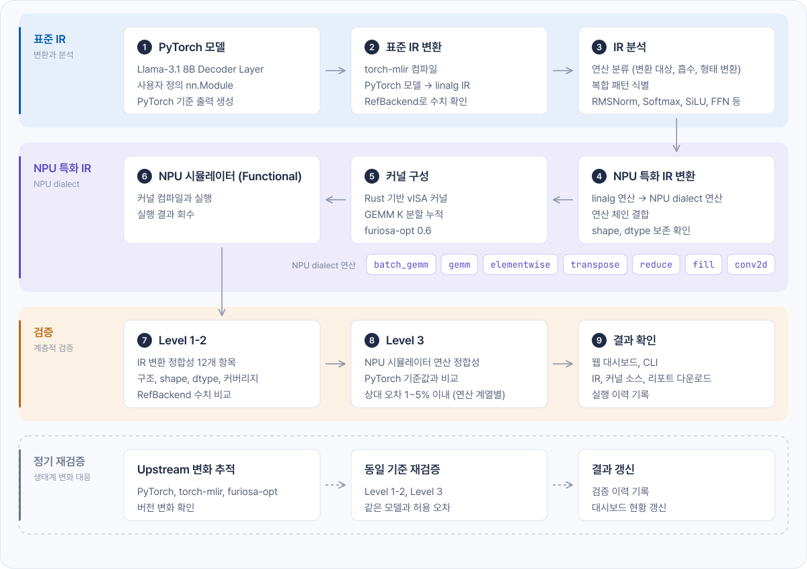
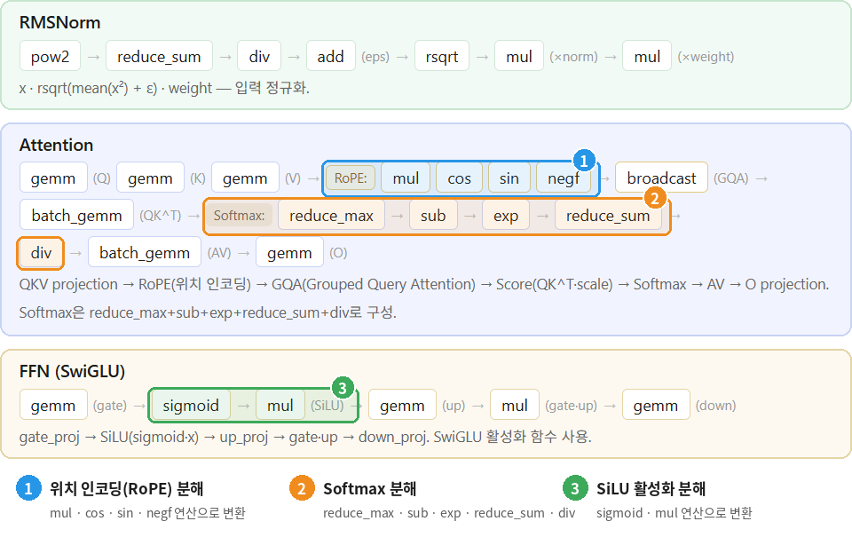

  

 

AI 모델 변환(표준 IR) 파이프라인은 PyTorch로 작성된 AI 모델이 NPU에서 실행 가능한 형태로 바뀌는 과정을 단계별로 보여주고 검증하는 오픈소스 도구입니다. 모델을 표준 MLIR(linalg) 표현으로 변환한 뒤 NPU 특화 IR로 낮추고, 커널을 NPU 시뮬레이터에서 실행해 PyTorch 결과와 수치를 비교합니다.

- **투명한 변환 과정** — 모델의 각 연산이 어떤 표준 IR 연산을 거쳐 어떤 NPU 특화 연산이 되는지 그대로 확인할 수 있습니다.
- **계층적 검증** — IR 구조의 정합성부터 NPU 시뮬레이터에서의 연산 결과까지 세 단계로 검증합니다.
- **생태계 변화 대응** — PyTorch, torch-mlir 등 상류 오픈소스의 변화를 추적하고 같은 기준으로 다시 검증합니다.

 

## 구조

PyTorch 모델은 torch-mlir을 통해 표준 MLIR의 linalg 연산으로 변환되고(1\~3), 파이프라인이 이 연산들을 분석해 NPU dialect 연산으로 다시 작성합니다(4). 이후 연산별 커널을 구성해 NPU 시뮬레이터에서 실행하고(5\~6), 변환 정합성과 연산 결과를 검증합니다(7\~9).

 

## 주요 기능

| 기능 | 설명 |
|:--|:--|
| 표준 IR 변환·분석 | PyTorch 모델을 linalg IR로 변환하고, 각 연산을 변환 대상·흡수·형태 변환으로 분류합니다. RMSNorm, Softmax, SiLU, Attention, FFN 같은 복합 패턴도 식별합니다. |
| NPU 특화 IR 변환 | linalg 연산을 NPU dialect 연산으로 다시 작성합니다. 예를 들어 `transpose`와 `batch_matmul`로 이어지는 연산 체인은 `transpose_rhs` 속성을 가진 하나의 `batch_gemm`으로 결합됩니다. |
| 계층적 검증 | Level 1-2에서 IR 변환 정합성 12개 항목을, Level 3에서 NPU 시뮬레이터 실행 결과와 PyTorch 기준값의 수치 정합성을 확인합니다. |
| 사용자 모델 분석 | 직접 정의한 `nn.Module`을 입력하면 변환 커버리지, 미지원 연산, 복합 패턴, 변환된 IR을 바로 확인할 수 있습니다. |
| 결과 확인 | 웹 대시보드와 CLI를 제공하며, 변환된 IR·커널 소스·검증 리포트를 내려받을 수 있습니다. |

 

## Llama-3.1 8B 연산 패턴 분석

Llama-3.1 8B Decoder Layer를 표준 IR로 변환하면 RMSNorm, Attention, FFN(SwiGLU)이 위와 같은 연산 체인으로 풀립니다. 위치 인코딩(RoPE), Softmax, SiLU처럼 하나의 연산으로 보이던 부분이 여러 기본 연산으로 분해되며, 파이프라인은 이 체인을 다시 복합 패턴으로 식별해 NPU 특화 연산으로 결합합니다.

 

## 검증 결과

Llama-3.1 8B Decoder Layer 한 개를 실제 모델 크기로 구성해 검증한 결과입니다.

| 항목 | 결과 |
|:--|:--|
| 모델 구성 | dim 4096, hidden 14336, attention head 32, KV head 8, head dim 128, RoPE와 Causal Mask 포함 |
| Level 1-2 IR 변환 정합성 | 12 / 12 통과 |
| 연산 변환 커버리지 | 100% (NPU dialect 연산 50개) |
| 복합 패턴 식별 | 8개 그룹 (RMSNorm 2, Softmax, SiLU, Attention, FFN, Residual 2) |
| Level 3 Decoder Layer 전체 | 상대 오차 0.62% (NPU 시뮬레이터 GEMM 1,664회) |
| 규모별 검증 | dim 64부터 4096까지 단계별 Decoder Layer 전체 통과 |
| 입력 다양성 | 입력 조건 8종에서 상대 오차 f32 0.50% 이하, bf16 1.07% 이하 |

> [!NOTE]
> Level 3는 **NPU 시뮬레이터(Functional)** 에서 연산 결과의 정합성을 확인하는 단계로, 실제 NPU에서의 실행 성능을 나타내지 않습니다. 기본 제공 모델의 Level 3 검증은 같은 조건(seed 42)의 PyTorch 모델에서 미리 생성한 기준값을 사용합니다.

 

## 빠른 시작

> [!IMPORTANT]
> 소스 코드와 Docker 이미지는 **v0.1.0과 함께 공개될 예정**입니다. 공개되면 Docker만 설치된 환경에서 명령어 한 줄로 변환과 3단계 검증을 직접 실행해볼 수 있습니다.

 

## 현재 한계

- 검증은 Llama 계열 Decoder Layer 구조를 중심으로 진행했습니다. 다른 구조의 모델은 변환 커버리지가 낮을 수 있으며, 미지원 연산은 분석 결과에 그대로 표시됩니다.
- reduce 계열 연산은 현재 CPU에서 처리합니다.
- 표준 IR 변환은 특정 버전의 torch-mlir에 고정되어 있습니다. 최신 torch-mlir의 FX importer 경로로의 이전을 준비하고 있습니다.

 

## 개발 환경

| 구성 요소 | 버전 |
|:--|:--|
| Python | 3.11 |
| PyTorch | 2.3.0.dev20240122+cpu |
| torch-mlir | 20240127.1096 |
| NPU 시뮬레이터 | furiosa-opt 0.6.0 (Rust nightly-2026-05-01) |

PyTorch와 torch-mlir의 해당 버전은 원래 배포처에서 더 이상 내려받을 수 없어, 검증에 사용한 설치 환경에서 wheel 파일을 재구성해 함께 제공할 예정입니다. 재구성한 환경은 원래 환경과 동일한 IR을 생성하는 것을 확인했습니다.

 

## 라이선스

이 프로젝트는 [Apache License 2.0](LICENSE)에 따라 배포됩니다. 함께 사용하는 오픈소스 구성 요소의 라이선스는 [NOTICE](NOTICE)에서 확인할 수 있습니다.

## 문의

사용 중 미지원 연산을 발견하셨거나 변환 결과에 이상이 있으면 [GitHub Issues](https://github.com/soadri/ai-model-ir-pipeline/issues)에 남겨주세요.

 

